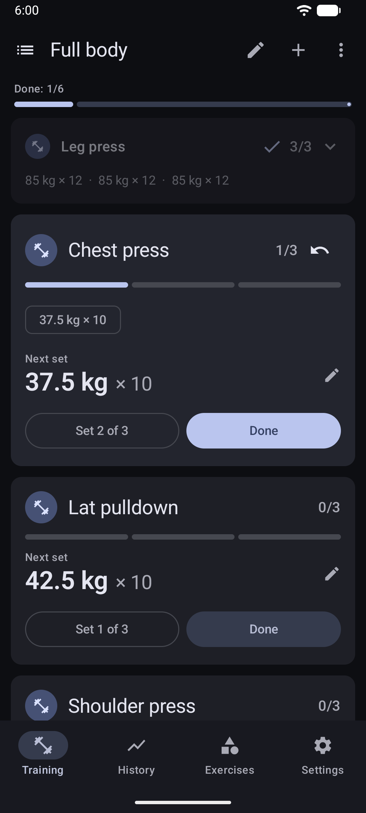
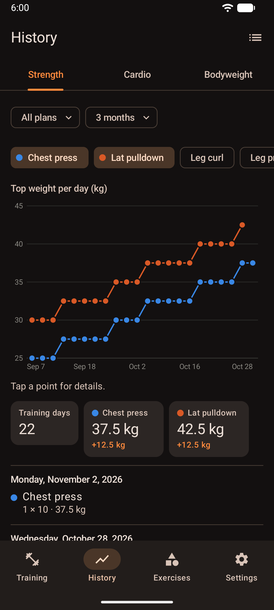
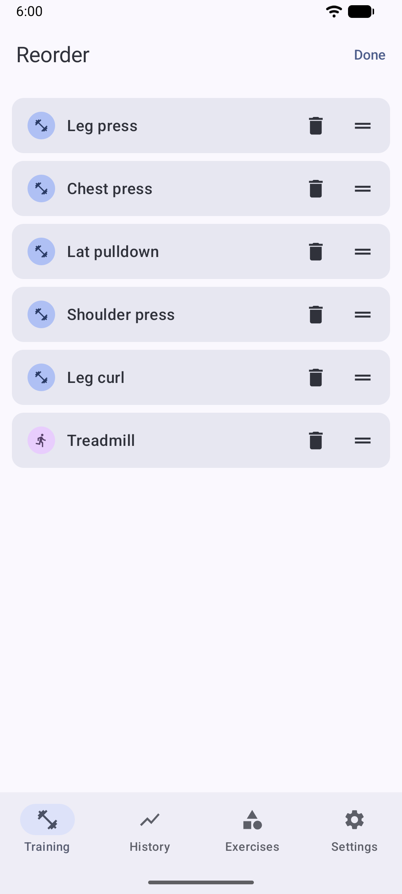
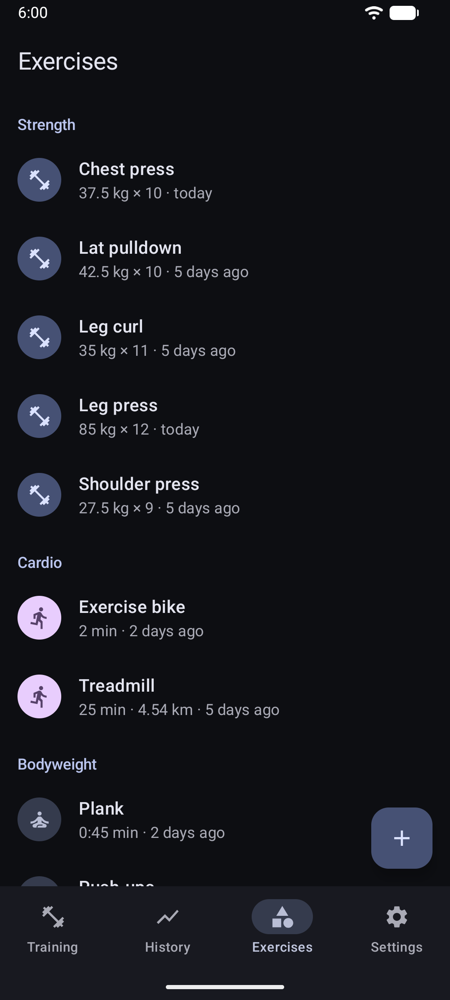
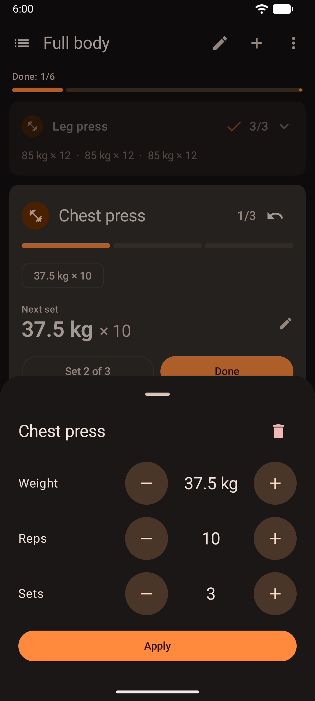

# Simple Workout Tracker

A deliberately simple Android app for logging gym training: machines, cardio and bodyweight exercises. Set up your exercises once, put them into training plans, and log a whole exercise with a single tap. Everything is stored locally on your phone: no account, no cloud, no network access, no ads.

<a href="https://play.google.com/store/apps/details?id=io.github.parcival42.workouttracker">Get it on Google Play</a>

| Workout | History | Plan | Exercises | Next set |
|---|---|---|---|---|
|  |  |  |  |  |

## Features

**Exercises**
- Three types: strength (machines with weights), cardio (duration, optionally distance) and bodyweight (push-ups, plank, ...; counted by reps or by time).
- Strength exercises have a minimum weight and a weight increment, so +/- always lands on a weight the machine actually offers.
- 36 templates to set up a gym in one step: 20 common machines, the activities running, cycling and swimming, and 13 bodyweight exercises. Template names follow the app language.
- Every exercise shows an icon (from its template, otherwise its type) and can get a fixed color for the history charts.
- Exercises are archived instead of deleted, so their history is kept. Archived exercises can be restored or deleted permanently.

**Training plans**
- Any number of plans. A plan is built and edited right in its workout: add exercises, reorder them by drag and drop, set weight, sets and reps (or duration) per exercise.
- A default plan (star) starts directly in the Training tab.
- Circuit plans: stations with a timer, rounds, rest between stations and a countdown, with sounds and vibration. Finished stations are logged automatically.
- Optional rest timer for normal plans, with its own rest between exercises if wanted.
- A plan can be restarted to train it more than once a day.

**Logging**
- One tap on "Done" logs all open sets of an exercise. Single sets can be logged one by one if the weight changes in between.
- Values come from the plan and are prefilled from your last training, so most of the time there is nothing to type.
- Cardio sessions log the duration and, for exercises that track it, the distance.
- "Quick log" records training outside of any plan.
- Logs can be undone, edited or deleted.

**History**
- Line chart per exercise: top weight per training day for strength, minutes, distance or speed for cardio, best reps or longest hold for bodyweight.
- Several exercises in one chart, filtered by plan and time range, with stat tiles and a day-by-day list below.
- A list of all logged entries, where each one can be edited or deleted.

**Settings and data**
- Color themes Dark, Light and Warm; dynamic colors from Android 12.
- English and German; from Android 13 the language can be chosen in the app.
- Personal defaults for new plan entries (sets, reps, cardio duration).
- Export and import of all data as a JSON file via the system file picker.

## Requirements

- Android 11 (API 30) or newer

## Building

Single-module Gradle build (`:app`) with Kotlin and Jetpack Compose.

```sh
./gradlew assembleDebug           # build a debug APK
./gradlew installDebug            # install it on a connected device or emulator
./gradlew test                    # unit tests
./gradlew connectedAndroidTest    # instrumented tests (database migrations), needs a device or emulator
./gradlew lint                    # Android lint
```

A JDK 17 or newer is required. If `JAVA_HOME` is not set, the JDK bundled with Android Studio works, e.g. on Windows:

```sh
JAVA_HOME="C:\Program Files\Android\Android Studio\jbr" ./gradlew assembleDebug
```

Release builds are signed with an upload key from `keystore.properties` in the project root (not in git). Without that file only debug builds work. The release process is described in [PLAYSTORE.md](PLAYSTORE.md).

## Documentation

- [Architecture and data model](docs/architecture.md): code structure, persistence, backup format and the behavior of each feature.
- [Development](docs/development.md): versioning, database migrations, conventions.
- [PLAYSTORE.md](PLAYSTORE.md): Play Store status, release process and store material (German).
- [TODO.md](TODO.md): open points and ideas.

## Tech stack

- Kotlin, Jetpack Compose, Material 3
- Room with exported schemas and real migrations
- Navigation Compose
- [Reorderable](https://github.com/Calvin-LL/Reorderable) for drag and drop
- Charts drawn with the Compose Canvas, no chart library
- Icons: Material Icons, [Tabler Icons](https://tabler.io/icons), [Lucide](https://lucide.dev), [Healthicons](https://healthicons.org); license texts are shown in the app under Settings > Open source licenses

## Privacy

The app has no internet access and collects no data. See the [privacy policy](PRIVACY.md).

## License

[MIT](LICENSE)
